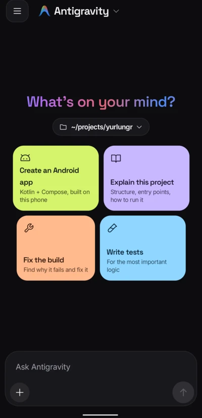
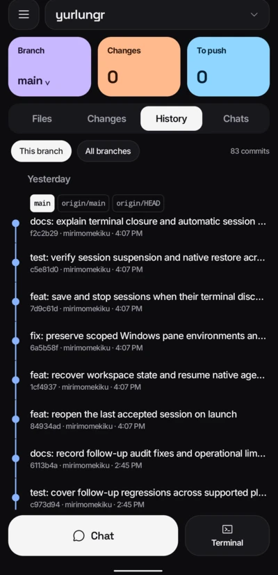
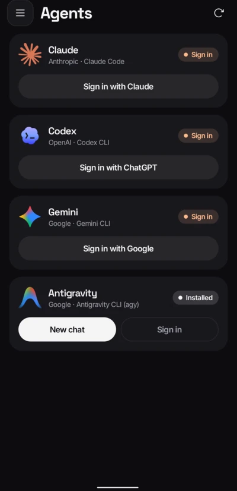

<h1 align="center">Yurlungr</h1>

<p align="center">
  <b>Coding agents in your pocket.</b><br>
  Chat with Claude Code, Codex, Gemini CLI and Antigravity running natively on your Android phone,<br>
  in a built-in Linux runtime. Build, git and ship from the same app. One APK, no Termux install.
</p>

<p align="center">
  
  
  
  
  
</p>

<p align="center">
  
  
  
  
  
</p>

---

## Highlights

- **Real agents, really on-device.** Each chat starts the agent's own CLI and talks to it over the
  [Agent Client Protocol](https://agentclientprotocol.com): streaming replies, thoughts, plans, tool calls
  with diffs, permission prompts, slash commands, model / effort / mode pickers, token use, image and
  file attachments.
- **An embedded Linux.** The official Termux bootstrap and package repos run inside the app (no proot, no
  separate Termux app): Node, git, Python, OpenJDK, Gradle and the Android SDK, all native on arm64.
- **Build APKs on the phone.** One tap sets up the SDK; agents or you run `./gradlew assembleDebug` and
  `yurlungr-install` opens the system installer.
- **Projects & git.** A workspace per project: file tree, Sublime-style editor, changes with diffs,
  commit, pull and push, branches and stashes, and a coloured commit graph. Your GitHub repositories
  (and your organisations') are listed, ready to clone.
- **A real terminal.** Termux's terminal view with sessions, a floating session rail and extra keys.
- **Two phones, one workspace.** Share one phone's agents with another over Tailscale with a pairing
  code; the other phone drives the same chats.
- **Stays alive.** A foreground service keeps agents running with the screen off. When an agent needs your
  answer you get a heads-up notification with sound, and a sticky banner inside the app; finished turns
  stay quiet.

## Download

Grab the APK for your phone's CPU from the [latest release](https://github.com/mirimomekiku/yurlungr-android/releases/latest)
and install it (allow installs from your browser or file manager when asked):

| APK | For |
|---|---|
| `yurlungr-<version>-arm64-v8a.apk` | Almost every phone from the last several years (recommended) |
| `yurlungr-<version>-armeabi-v7a.apk` | Older 32-bit phones |
| `yurlungr-<version>-x86_64.apk` / `-x86.apk` | Emulators and x86 devices |
| `yurlungr-<version>-universal.apk` | Any of the above, if you're unsure (slightly larger) |

Not sure? `adb shell getprop ro.product.cpu.abi` prints your phone's ABI. Each release lists SHA-256
checksums in `SHA256SUMS.txt`.

Changes in this version: [0.0.6 release notes](docs/releases/0.0.6.md).

## Quick start

**Requirements:** an Android phone (Android 7.0+; arm64 is the tested target, developed on a ROG Phone 3
with Android 12 and a Pixel 6), about 4 GB free. To build from source: JDK 17+ and USB debugging.

```sh
git clone https://github.com/mirimomekiku/yurlungr-android.git
cd yurlungr-android
./gradlew assembleDebug
adb install -r app/build/outputs/apk/debug/app-arm64-v8a-debug.apk
```

Then, on the phone:

1. **Set up the Linux environment.** The first-run System checks screen offers *Install* (downloads the
   ~30 MB Termux bootstrap). Fix anything amber: battery optimisation, notifications, and on Android 12+
   the background process limit (the dialog shows the one-time `adb` command).
2. **Install the agents.** Agents → ⟳ (or *Install*) runs `agents-setup.sh` in a terminal: about 1 GB.
   Or open System checks → **Install tools** to install them together with git, Node.js, Python, SQLite and
   any optional packs in one go.
3. **Sign in.** Each agent's card has *Sign in*, which opens its own login in a terminal; the browser
   opens by itself and returns to the app.
4. **Chat.** Pick an agent and a project folder on the start screen and type.
5. **Build Android apps** (optional): Settings → System runtime → *Set up* the Android SDK (~600 MB plus
   Gradle downloads, includes a test build).

## Features

<details>
<summary><b>Chat</b></summary>

- Start screen with an agent picker (showing each agent's logo and install / sign-in state), a project
  folder chip and suggestion tiles. The first message is queued until the agent is ready, including
  after a sign-in detour.
- The chat header is the agent pill (`● Claude · Sonnet 5.5 ⌄`); its dot shows the state and its menu has
  the title, folder, context use, *Checkpoints*, *Approval rules*, *Artifacts*, *Usage*, *End session* and
  *Delete chat*. The agent's model, effort and mode are
  pill pickers below it.
- Attachments (＋): photos and files go to `<project>/.yurlungr/attachments/` (git-ignored) and are sent as
  ACP images, embedded text resources or file links, depending on what the agent accepts. Large photos
  are downscaled.
- New chats offer **Permissions: Agent default / Skip (YOLO)**. Skip selects the agent's advertised
  full-access ACP mode (or Antigravity's `--dangerously-skip-permissions` launch flag) before sending
  the first prompt, and is remembered with that chat. If the installed agent doesn't expose such a
  mode, the prompt stays queued and the chat shows an error. Existing chats expose the agent's supported
  modes in the mode picker; Antigravity's launch flag requires a new chat to change. Remote new chats
  have the same setup option.
- Replies use GitHub-flavoured CommonMark: headings, nested lists, task lists, quotes and `> [!NOTE]`
  callouts, tables with column alignment, strikethrough, footnotes, bare URLs and clickable links.
  Code blocks get syntax colours for their language, from the editor's lexer and theme, plus a
  **Copy** button. Local file links open in the file viewer (Markdown previews or the text editor);
  remote file links aren't opened on the client. Markdown previews also resolve relative links.
- Chats are saved after every turn and restored as history after a restart; opening one restarts the
  agent and reloads its session (`session/load`).
- **Checkpoints:** before and after every prompt, the chat's project is snapshotted into a separate
  repository kept in the app's files. It works in folders that aren't git repos and never touches
  the project's own `.git`; build and dependency folders are left out. Chat ⋮ → **Checkpoints**
  lists each prompt with what it changed:
  - **Diff:** what the prompt changed;
  - **Restore to before:** puts the files back, removes files added since, and takes a snapshot
    first so the restore can be undone too. The agent isn't told, so mention it in your next message.

  Chats in the home folder itself aren't snapshotted.
- **Usage:** Chat ⋮ → **Usage** shows prompts, time working and files changed, plus the context window
  and cost when the agent reports them over ACP (nothing is estimated). A project's Chats tab adds
  them up.
- **Message queue:** while an agent works, Send becomes **Add to queue**. Queued messages show as chips
  above the message box (tap one to remove it) and go out in order when the turn ends. **Send now** stops
  the running turn and sends the first one; after a manual Stop the queue waits. The queue lives in the
  app, so it behaves the same for every agent (Gemini, for one, would cancel the running turn if a second
  prompt reached it). It isn't available on chats mirrored from another phone yet.
- **Prompts, mentions, drafts and voice:** ＋ → **Prompts** opens a library you can add to (what you typed
  can be saved as a prompt). Typing `@` suggests project files to mention. Unsent text is kept per chat
  across restarts, and the mic button dictates with the phone's speech recognizer.
- **Copy:** long-press your own message to copy all of it; agent replies are selectable.
- **Artifacts:** Chat ⋮ → **Artifacts** lists the files the agent created or edited, grouped by prompt and
  marked New or Edited. It combines the agent's edit diffs with each prompt's checkpoint snapshot, so files
  a command wrote (a chart from a script, a build's output) show up too; chats mirrored from another phone
  list only what the diffs show, and can't open the files. Tap one to preview it (see **File previews**
  below), with Copy path, Share and Edit.
- **Approval rules:** Chat ⋮ → **Approval rules** switches on auto-approval per kind of tool call (read,
  search, fetch, think, edit, run) for the project; the permission card also offers *Always allow … here*.
  A matching request is approved once, quietly, and the chat says so. Edit and run are marked as risky;
  anything not switched on still asks. Rules never cover edits to agent or tool configuration (`.claude/`,
  `.gemini/`, `.mcp.json`, `.env`, git hooks…), and search or fetch rules only match calls that name files
  in the project.
- **Permission cards** show what you're approving: the command, the files and the changes (expandable),
  and the notification says the command or files too. File locations in tool cards open the editor at
  that line.
- **Commands the agent runs** show their output live in the chat, with **Stop**; they end with the session.
- **MCP servers** in the project's `.mcp.json` are passed to every agent in trusted projects.
- **Commands:** ＋ → **Commands** lists every slash command the agent advertises (Claude and Kilo include
  their skills and plugin commands), with search; tap one to insert it. Typing `/` still suggests them inline.
- **Skills & commands** (Chat ⋮, or the wrench on the Agents screen): per agent, lists its skills (folders with a
  `SKILL.md`) and custom command files from the project and your user folders, opens them in the editor, creates
  new ones from a template, installs skills from a Git repository (a `git clone` in a terminal) and deletes them
  (confirmed, only inside the skills folders). Plugins run the agent's own command in a terminal: Claude
  (`claude plugin`), Codex (`codex plugin`), Gemini (`gemini extensions`), Qwen, Auggie, MiniMax, Qoder and Pi,
  limited to the sub-commands each CLI documents. Skill folders are known for Claude, Codex, Gemini, Qwen, Kimi,
  Auggie, Command Code, MiniMax, Pi, Qoder, OpenCode, Cline, Kilo, Kiro and Amp; Copilot, Goose, Cursor, Antigravity
  and the others aren't managed yet. Skills and plugins can make an agent run code, so only add ones you trust.
- **Needs your answer:** only an approval request notifies (its own high-priority channel, with sound
  and vibration). In the app the same request shows a sticky banner that stays until it's answered, and
  tapping it opens the chat.
- Code: `chat/` (`ChatSession`, `ChatScreen`, `Composer`, `PromptLibrary`, `Artifacts`, `ApprovalRules`, `UrgentBanner`, `AcpExtras`, `Attachments`, `ChatStore`, `Checkpoints`),
  `acp/AcpConnection.kt`.

</details>

<details>
<summary><b>Projects & git</b></summary>

- **Workspace** per project: the name (tap to switch projects or open *All projects*), Branch / Changes /
  To push stat tiles, and Files · Changes · History · Checks · Chats tabs. The tiles and tabs slide away while
  you scroll down a tab and come back when you scroll up. The bottom dock keeps to three buttons:
  **Chat**, the project's main action (Run/Open for web apps, Build for Android, otherwise Terminal), and
  **More**. More opens a sheet with the rest (Setup, Git, Terminal, Build, Run options), each with a line
  saying what it does. When only three buttons are needed, all of them show. Dots mark missing
  dependencies and a web server that's starting or running. The sidebar's *Projects* reopens the last workspace.
- **Files** is a tree with indent guides and icons by file type. In a repository:
  - A segmented filter: **All · Changed (count) · Source** (without ignored files) **· Ignored**. Changed lists every changed path, including deletions.
  - A summary by kind ("6 new · 3 modified · 2 staged") in the rows' colours, and **Collapse all**.
  - Changed files have coloured names and a status letter (U/M/A/D/R/!), with a tick when staged. Folders show how many changed files they hold, and ignored files are faded.
  - Ignored paths come from Git itself, so nested rules, exceptions and global exclusions apply.

  Pull down to re-read the tree and Git's state. Tapping a Markdown file (`.md`, case-insensitive, also
  `.markdown` / `.mdown`) opens a rendered viewer with **Edit** to open the text editor; Back from the
  editor returns to the preview. Other files open in the editor.
- **Changes**:
  - **Sync card:** the branch, ahead/behind counts, and **Pull** and **Push** (or *Publish to GitHub*, using `gh repo create`).
  - **Groups:** Conflicts, Staged and Changes, each with Stage all, Unstage all or Mark all resolved.
  - **Files:** tick a file to stage or unstage it, tap it for its diff, or use ⋮ for full screen, Open file and **Discard** (confirmed first; files git doesn't track yet are deleted).
  - **Single hunks:** each change in a diff has **Stage hunk** / **Unstage hunk**.
  - **Unfinished merge, rebase, cherry-pick or revert:** a banner with **Continue** (or **Conclude merge** when nothing is left to commit) and **Abort**.
  - **Still stashed:** if *Get latest changes* or *Stash & switch* left your work in a stash, a banner offers **Restore**.
  - A stale `index.lock` left by a killed git command can be removed from the error, once nothing else is using the repository.
  - **Commit box:** pinned at the bottom. It commits only the staged files when there are any (with *Commit all* beside it), otherwise everything.
  - It also offers a standard `.gitignore` when build output shows up.
- **Pull** (`--ff-only`) and **Push**, which sets the upstream on
  the first push, run in a live terminal in a bottom sheet, showing git's progress and any prompts.
  The terminal session ends when git exits. The sheet stays open with the result until you close it.
- **Git actions** (dock → More): one tap each for *Get latest changes* (stash, pull, stash pop), *Sync*,
  *Publish branch* / *Push*, and *Undo last commit*, plus agent versions (fix conflicts, write the commit
  message, review changes). With `gh` signed in, **Open pull request #N** opens the branch's pull
  request, or **Create pull request** makes one (title and description from its commits) once the branch
  is pushed.
- **Branches** (tap the Branch tile): pull, create, rename, switch (remote branches become tracking branches;
  uncommitted changes can be stashed first or brought along), and stash pop / apply / drop (drop asks
  first). **Clean up** lists merged branches and those whose remote branch is gone, and deletes them safely.
- **History** is a commit graph like `git log --graph`, grouped under Today / Yesterday / dates (each
  with its commit count). Rows show author avatars, branch, remote and tag labels, and "to push" marks.
  A This branch / All branches switch and a commit count sit above the list. **Load 300 more** pages
  further back; long-press a file in the Files tab for **History of this file**.
  - **Filters:** a search bar (message, or a commit hash) and a filter sheet for author and date
    (today, 7 days, 30 days, a year). Active filters show as removable chips.
    Git applies them, so they cover the whole history, not just the commits shown.
  - **Commit details:** the changed files and a proper diff viewer, with:
    - +/− counts and line numbers for both sides;
    - added and removed lines tinted, with the changed words highlighted;
    - hunk headers, a wrap toggle and paging for long diffs;
    - a full-screen view.

    The Changes tab uses the same viewer.
- **All projects** lists folders on the phone and, when `gh` is signed in, your GitHub repositories and
  those of your organisations (grouped by owner), marked Cloned, Local or not cloned, with search.
- Pull down to refresh project folders, Git status and GitHub repositories without clearing search
  or filters. **New project** and **Clone from URL** use keyboard-aware bottom sheets with folder
  previews and validation for invalid or existing names.
- **Trusted projects:** cloning a repository you don't own (not yours or your organisations' on GitHub)
  marks it untrusted. Until you tap **Trust this project**, it doesn't install and run after cloning, start
  language servers, load its Prettier config, put its committed `.venv` on PATH or give its `.mcp.json`
  servers to agents. Pull request checkout always runs with git hooks off, and merging only merges the
  commit you reviewed.
- **Run** starts with saved settings (or defaults), installs missing project dependencies, chooses a
  free port and opens the preview when ready. Long-press Run or choose **Run options** for setup.
  Vite (including SvelteKit), Next.js, Astro, Nuxt, Angular, Create React App, Expo web, Parcel,
  Webpack Dev Server, plain static sites and projects with development/start scripts are detected.
  Detection reads manifests and common app folders without executing configuration. Android's Build
  action remains available when both capabilities are present. Workspace installs use the workspace root.
- **Public link:** a running web server's ⋮ menu has **Share public link** (also the globe next to a
  port in Servers). It uses cloudflared's account-free Quick Tunnel from the *Servers & tunnels* pack: no
  account, no domain, and a random `trycloudflare.com` address that changes every run. A confirmation
  comes first, because anyone with the link can reach the server. Copy, Share, Open or Stop sharing; the
  link is live only once Cloudflare registers the connection.
  - It stops with the server, or after the time you pick (15 min, 1 h by default, 4 h, or until stopped);
    a notification with **Stop** stays up while it's live, and Servers shows the time left.
  - Links to Yurlungr's own runs need an access key by default: the copied link, the QR code and Open
    include it, and anyone without it gets "401".
  - Vite, Astro, Nuxt, SvelteKit, webpack and other dev servers that refuse unknown hosts work through it.

  Quick Tunnels have no uptime guarantee, no server-sent events and a 200-request cap.
- Run setup offers **Framework CLI**, **Project script**, or **Custom command**, plus npm, pnpm, Yarn or Bun,
  dependency installation, public port, readiness route and startup timeout. Framework CLI checks the
  installed CLI's options and skips project script setup steps. Script mode preserves compound commands;
  simple recognized dev commands receive routing flags. Custom/compound servers must honor the supplied
  `HOST=127.0.0.1` and private `$PORT` (the browser uses the public port shown in the app).
- Next.js defaults to **Framework CLI → Compatibility (Webpack)**. This avoids Turbopack's native-only
  paths while allowing Next.js's matching WASM compiler fallback. Compatibility also detects missing
  Lightning CSS bindings (including Tailwind/PostCSS) and caches the exact official `lightningcss-wasm`
  version outside the project. Only that run's Node processes use the fallback; working native bindings
  stay in use. Scripts that explicitly enable Turbopack show a direct compatibility action. A compiler failure
  offers an explicit **Try compatibility** action to download the exact Next.js compiler into its generated cache and retry.
  This does not rewrite package manifests, lockfiles or global runtime settings. Use Project script when
  the repository requires `predev` or other setup commands; Default bundler is also available.
- The **Run** tile stays disabled while preparing, installing, starting, compiling or stopping;
  it becomes **Open** once the server is running, without starting a duplicate run.
  Each run owns a loopback listener and a terminal with live logs. The card distinguishes installing,
  starting, compiling, running, setup errors and compatibility failures. The preview opens only after
  the initial route returns HTTP 200–399 and the unique run health check passes. HTTP and HMR WebSockets
  are proxied with the public origin preserved for SSR and authentication.
- The server card offers **Preview/Open**, **Logs**, **Run setup**, compiler recovery, and confirmed
  **Stop/Restart**, with the framework, folder, progress and an address you can tap to copy. Stop/Close
  ends its process group; logs remain unless the terminal is closed. The foreground runtime service
  keeps runs alive while browsing. App restarts stop stale runs rather than adopting saved PIDs.
  Static serving blocks dotfiles and paths outside the app folder. Native-only packages, required
  environment variables, databases and incompatible Node requirements can still require project setup;
  detection alone is not a compatibility guarantee and no framework is blocked pending validation.
- **Terminal** from a project offers the terminals already open there, or a new one.
- **Checks** (a project tab) runs the project's compile/lint checks and its tests in a terminal,
  then shows what they found. Their output is saved under `.yurlungr/` in the project, which is
  git-ignored automatically.
  - **Check:** problems by file, with the line and message. It reads tsc, ESLint, Kotlin/Gradle,
    javac, `cargo check`, `go vet`, ruff or Python syntax errors, and `dotnet build`.
  - **Run tests:** passed, failed and skipped, plus each failure's message and location. It reads
    JUnit XML (Gradle, pytest, Vitest), Jest's JSON report, and `go test -v` / `cargo test` output.
  - Tap a problem or failure to open the file at that line. **Fix with agent** starts a chat with
    the list, using the project's default agent.
- **Search in files** at the top of the Files tab runs ripgrep over the project. Results open at
  their line. It respects
  `.gitignore`, skips `.git`, and supports plain text or a regular expression; tap a result to open
  the file.
- **Scripts** (in the dock's More sheet) runs the project's tasks with one tap, in a terminal:
  package.json scripts (with its package manager), deno tasks, composer scripts, make targets, just
  recipes, and the usual Gradle, Cargo, Go, pytest, mix and .NET commands.
- **Agent settings** (More → Agent settings), per project:
  - **Chat starts:** choose the agent Chat starts. Long-press Chat to pick another.
  - **Instructions:** open or create AGENTS.md, CLAUDE.md, GEMINI.md and QWEN.md, or point the others
    at AGENTS.md with one tap (`@AGENTS.md`).
  - **MCP servers:** add, edit or remove them in `.mcp.json` (a command or an HTTP URL), copied to
    `.gemini/settings.json` and `.qwen/settings.json` unless you turn that off. Codex only has global
    servers.
- **Preview:** a running web app opens inside the app, with reload, back and forward, a phone or
  desktop layout, the page's console and errors, and *Open in browser*. Links to other sites open
  in the browser. Debug builds can also be inspected from a computer's `chrome://inspect`.
- **Setup** detects the project's tech stacks from their manifest files, in the root and common app
  folders (`app/`, `frontend/`, `apps/*`…), and installs their dependencies in a terminal with a log
  (`~/project-setup.log`). Each stack card shows the Termux packages and commands it will run:
  - Node.js with npm, pnpm, Yarn (Yarn 2+ through corepack) or Bun, picked from `packageManager` and
    the lockfile (Expo, React Native, Vite, Next.js… are named); workspaces install once at the root;
  - Deno (`deno install`);
  - Android/Kotlin and Jetpack Compose (Gradle wrapper: downloads Gradle, plugins and dependencies without building);
  - Python in a project `.venv`, with uv (`uv sync`) or Poetry when the project uses them. The venv
    is made with system site-packages, so the prebuilt packages from *Python data & science* are
    used instead of compiled; pip still installs into the venv;
  - Dart (`dart pub get`), Rust, Go, Ruby, PHP, Java (Maven), Swift, Elixir (`mix deps.get`), Zig,
    .NET (`dotnet restore`), Crystal, Nim and Lua (LuaRocks).
  Each card lists the **runtimes** the stack needs (Node.js, pnpm, Bun, JDK…), each marked installed
  or missing. Install sets up missing runtimes first, then the dependencies. Flutter is detected but
  can't be installed: its SDK isn't available for Android's Linux environment. Node projects with
  native add-ons that compile on install (sharp, bcrypt, canvas, sqlite3, better-sqlite3, node-pty,
  node-sass) also get Python, Clang, make, pkg-config and the libraries those add-ons link (libvips,
  cairo…). These install only when you tap Install. Notes explain what
  else won't work on the phone (Expo native builds, native add-ons).
  - **Banner:** when a project needs runtimes or dependencies (right after cloning, say), it says
    which ("Needs Node.js and pnpm · dependencies not installed") and offers **Install**. **Not now**
    hides it for that project.
  - **Automatic setup** (a switch in the Setup sheet, off by default): opening a project that needs
    something starts the install by itself, once per need, so reopening it doesn't repeat it.
  - **Run** on a web app whose runtime is missing installs it first instead of stopping.
- **Git** (next to Terminal) opens one-tap routines:
  - **Get latest changes:** saves your uncommitted work, pulls (merging if the branches diverged), then puts your work back (stash → pull → stash pop).
  - **Sync:** the same, then pushes.
  - **Push** or **Publish branch.**
  - **Undo last commit:** only while it's on no remote branch; keeps the changes.
  - **Branches & stashes.**

  Each routine stops at the first problem and says where things were left. Your work is never discarded.
- **With AI** actions do the same work with an agent of your choice, in a new chat:
  - **Get latest changes & fix conflicts:** runs the routine and, if a pull or the stash pop conflicts, the agent resolves the conflicts. It finishes the merge (or continues a rebase, cherry-pick or revert), or leaves your restored work uncommitted.
  - **Fix merge conflicts.**
  - **Write commit message & commit.**
  - **Review my changes.**

  The agents never push.
- Git runs with `GIT_TERMINAL_PROMPT=0`, so a missing login fails fast instead of hanging.
- Code: `projects/` (`Git`, `GitGraph`, `ProjectScreen`, `ProjectsScreen`, `HistoryView`, `BranchSheet`).

</details>

<details>
<summary><b>Editor</b></summary>

- Syntax colours for about 25 languages from a small pure-Kotlin lexer, line numbers that follow wrapped
  lines, current-line highlight, undo / redo, find and replace, auto-indent and bracket closing, a symbol
  row above the keyboard, word wrap, read-only mode, and a Ln / Col / language / indent / EOL status bar.
- Themes: Monokai, Mariana, Dracula, One Dark, GitHub Dark, GitHub Light and Solarized Light, plus a text
  size (Settings → Editor).
- *Format with Prettier* runs `npx prettier@3.3.3` in the file's folder (so project config applies) for
  JS/TS/JSON/CSS/SCSS/HTML/Markdown/YAML. In untrusted projects it uses Prettier's defaults, without the
  project's config or plugins. The result is applied only if you didn't type meanwhile.
- **Files changed by an agent** reload by themselves when you have no unsaved edits; otherwise a banner
  offers Reload, Diff or Keep mine.
- **File previews:** some files open as a preview instead of text, from the Files tab, chat links or
  Artifacts. Each has **Copy path** and **Share** (files inside the app's storage):
  - pictures (PNG, JPG, WebP, GIF, BMP, ICO): a viewer with pinch zoom, pan and double-tap to zoom or reset;
  - HTML and SVG pages, rendered with scripts on but sandboxed: network loads are blocked and only files from
    the page's own folder load, since agent-written or downloaded HTML is untrusted;
  - CSV and TSV as a scrollable table (quoted fields, first 2,000 rows and 40 columns);
  - JSON as formatted text in Artifacts (a `.json` file from the Files tab still opens in the editor);
  - HTML, SVG and tables have **Edit** for the source. Files over 5 MB aren't previewed as tables or JSON.
  There's no PDF preview yet.
- Markdown opens in a read-only rendered viewer with an **Edit** action; other text files open directly
  in the editor. CRLF files are edited as LF and saved back as CRLF; files over 1 MB or binary files
  are not opened. The viewer:
  - renders lazily, so large documents stay smooth;
  - has **Find** (a match count, with previous and next) and an **Outline** sheet of the headings;
  - follows `#section` links and footnotes within the file, using GitHub-style heading anchors;
  - adjusts the text size, shows the raw text, and offers **Copy all** and **Share**;
  - reloads when the file changes on disk, and remembers where you were between Preview and Edit.
- README-style HTML is shown safely:
  - `<details>`/`<summary>` become collapsible sections, which open when a search matches inside them;
  - ``, `<br>`, `<kbd>`, `<sub>`/`<sup>` and similar tags work;
  - script and style contents are dropped, and other tags are stripped, never executed;
  - YAML front matter is shown as a small card.
- Images in the project folder are shown downscaled. Remote images load only after a tap, so opening
  a file doesn't contact their server. SVG images show their alternative text.
- **Open at a line:** search results, problems and test failures open the editor at their line.
- **Language servers.** When one is installed for the file type, the editor starts it for the
  project (trusted projects only, since a server can run project code): rust-analyzer, gopls, clangd, lua-language-server (the Language servers and Build tools
  packs), and typescript-language-server, Pyright, pylsp, ruff or bash-language-server.
  - **Problems:** a dot in the gutter on lines with problems, and a line above the status bar with the
    count; tap it for the list.
  - **Find definition:** goes straight to the definition.
  - **Show info:** the type or documentation of what's under the cursor.
  - **Complete:** in the ⋮ menu, or the **Complete** chip above the keyboard.
- **Find definition** without a language server searches the project for lines that look like a
  definition (`fun`, `class`, `def`, `function`, `const x =`…) and opens the one you pick.
- **Tabs:** files you open show as tabs above the editor. Switching keeps unsaved edits in memory
  (a dot marks them); closing another tab drops its edits.
- **Resolve conflicts:** a file with conflict markers opens a merge view, from Changes or the
  editor's ⋮ menu. It shows each conflict as ours, the common base (when git recorded it) and
  theirs, with **Use ours**, **Use theirs**, **Both** or **Edit**. **Save & mark resolved** stages it.
- **Snippets** (⋮ → Insert snippet) for Kotlin, TypeScript/JavaScript, Python, Go, Rust, HTML,
  shell and Markdown. In the Files tab, **+** creates a new file (folders included) from a template
  for its type.
- **SQLite databases** (`.db`, `.sqlite`, or any file with the SQLite header) open in a browser:
  tables and views with rows 100 at a time, the schema, and SQL. Read-only unless you turn on
  *Allow changes*.
- **Blame** (⋮ menu): who last changed each part of the file, with the commit and when; tap to jump there.
- Recently opened files appear in **Search everything**.
- Code: `editor/`.

</details>

<details>
<summary><b>Terminal</b></summary>

- Termux's `terminal-view` with multiple sessions, a floating session rail (tap the session title),
  `[‹ 1/3 ›]` switching, and two rows of extra keys (esc, ctrl, alt, tab, arrows, home/end, page keys).
- Long-press a numbered session tile to open a bottom sheet with **Rename**, **Restart process**,
  **End process**, or **Close session**. Restart, End and Close require confirmation; the rail's ×
  shortcut also asks before closing.
  Ending leaves the exited terminal visible; closing removes the tab. Restart reruns the original session command.
- The **keyboard icon** pill to the right of the session arrows directly shows/hides the extra-key rows,
  remembered across launches. It uses the same container as the session switcher.
- New terminals open with a welcome screen: a small wave mark in the app's colours and a rounded status card
  sized to the terminal (28–40 columns). It shows the session, working folder, Git branch (when in a
  repository), working/idle chats, approval count, and sign-in marks for the installed agents only.
  A key appears only for the marks shown. Run `yurlungr-status`
  to refresh after changing folders or signing in. Sign-in indicators use the same file-presence hints
  as the app; Antigravity stays unknown. No credentials are read or displayed.
  Uses Termux's `~/.termux/motd.sh` hook; an existing custom hook and `$PREFIX/etc/motd` are preserved.
  `~/.hushlogin` still suppresses the automatic welcome, and `NO_COLOR` disables status styling.
- **"Finished" notifications:** a command run from the app (build, install, tests, Scripts) that
  takes 20 seconds or more posts a notification when it ends, with its exit status. Tapping it opens
  that terminal. Scripts and agents can send their own with `yurlungr-notify "Title" "details"`.
  While the app is open these show as a toast. The *Finished tasks* channel can be turned off in
  Android's settings.
- **Search everything** (the sidebar's first item, or long-press ☰ / ‹ on any screen) finds
  screens and actions, projects, recently opened files, chats (by title, and by what was said in them,
  from 3 letters), and the last project's scripts and files. It ranks matches that start a word first, and Enter runs the top result.
- **Shortcuts outside the app:**
  - Quick Settings tiles: **Dev servers** (how many run, tap for Servers) and **Terminal**;
  - a home-screen widget with New chat, your last project, Servers with a running count, and an
    **Ask an agent…** bar that opens New chat with the keyboard up.
- **Share to Yurlungr** from any app: text, links, images or files. Pick a project and an agent, edit
  the message, then **Ask** (files go as attachments, up to 10 MB each) or **Save to project**.
- **Wide screens** (tablets, unfolded foldables): a file opened from a project shows beside it.
- **Themes:** Settings → Appearance adds an **accent colour** (Default, Lime, Lilac, Sky, Peach,
  Rose) and **Pure black** for dark mode on OLED screens.
- **Feedback** (Settings): vibration and sound when a task finishes, fails or an agent needs you,
  each switchable. **Battery and heat warnings** ask before builds, installs, tests and setups when
  the battery is under 20% and not charging, or the phone is over 42 °C.
- **Launcher shortcuts:** long-press the app icon for New chat, Ask an agent, your last project, Servers and Terminal.
- **Tour:** a first-run walkthrough (also in Settings) with a sample project to try Run, Preview and
  an agent on.
- **Accessibility:** section labels are headings, tabs announce their selection, Git status letters
  are read as words ("Modified"), and dock dots say what they mean. Terminal and diff text follow
  Android's font size.
- **Activity** (sidebar): the chats that are working or waiting for you, with their plan steps, queued
  messages and a Stop button, and per-agent totals of chats, prompts, tokens and cost (what each agent
  reports, for chats opened since the app started). Opening the sidebar also puts the keyboard away.
- **Servers** (sidebar):
  - the web apps the app runs (Preview, Logs, Stop);
  - **Public links** that are live, with Share and Stop;
  - listening ports: the usual development ports (Vite, Next.js, Astro, Angular, Django, Flask,
    Expo, PostgreSQL, Redis, MariaDB, Ollama…), each with Preview. Android doesn't let apps list
    every open port, so these are found by trying to connect;
  - the runtime's processes, with memory and uptime, and **Stop** (SIGTERM) or **Force kill**.

  It refreshes every few seconds.
- Code: `terminal/`, `runtime/RuntimeStatus.kt`, `runtime/TaskNotifications.kt`, `web/ServersScreen.kt`, `assets/motd.sh`.

</details>

<details>
<summary><b>Agents</b></summary>

| Agent | Installed with | Started as |
|---|---|---|
| Claude Code | npm (`--os=linux --cpu=arm64 --libc=glibc`), then `patchelf` to Termux's glibc loader; a wrapper unsets `LD_PRELOAD` | `claude-agent-acp` with `CLAUDE_CODE_EXECUTABLE` |
| Codex | Termux package `codex` (npm's build does not run on Android) | `codex-acp` with `CODEX_PATH` |
| Gemini CLI | `npm i -g @google/gemini-cli` | `gemini --acp` |
| Antigravity (`agy`) | Google's installer, which installs the native `android_arm64` build | `agy acp` (sign in with `agy acp --login`) |
| Qwen Code *(optional)* | `npm i -g @qwen-code/qwen-code` | `qwen --acp` (sign in with `qwen`, then `/auth`) |
| Kimi Code *(optional)* | `npm i -g @moonshot-ai/kimi-code` | `kimi acp` (sign in with `kimi login`) |
| Auggie *(optional)* | `npm i -g @augmentcode/auggie` | `auggie --acp` (sign in with `auggie login`) |
| Command Code *(optional)* | `npm i -g command-code` | `commandcode acp` (sign in with `commandcode login`; its short name `cmd` clashes with Android's own `cmd`) |
| Copilot *(optional)* | `agent-install.sh copilot`: the `@github/copilot-linux-arm64` glibc build, started through Termux's glibc loader | `copilot --acp` (sign in with `copilot login`) |
| Goose *(optional)* | `agent-install.sh goose`: the `aarch64-linux-gnu` release, started through the glibc loader | `goose acp` (set up with `goose configure`) |
| OpenCode *(optional)* | `agent-install.sh opencode`: the `linux-arm64` glibc release, interpreter patched like Claude Code | `opencode acp` (sign in with `opencode auth login`) |
| MiniMax Code *(optional)* | `npm i -g @minimax-ai/code` | `mcode acp` (sign in with `mcode login --region global`) |
| Pi *(optional)* | `npm i -g pi-acp @mariozechner/pi-coding-agent` (the ACP adapter and the CLI it drives) | `pi-acp` (sign in with `pi`, then `/login`) |
| Qoder *(optional)* | `npm i -g @qoder-ai/qodercli` | `qodercli --acp` (sign in with `qodercli`, then `/login`) |
| Cline *(optional)* | `agent-install.sh cline`: the `@cline/cli-linux-arm64` glibc Bun build, interpreter patched | `cline --acp` (sign in with `cline auth`) |
| Kilo Code *(optional)* | `agent-install.sh kilo`: the registry's `linux-arm64` glibc release (an OpenCode fork), interpreter patched | `kilo acp` (sign in with `kilo auth login`) |
| Cursor *(optional)* | `agent-install.sh cursor`: the registry's `linux/arm64` package with its own Node, which is patched; credentials kept in a file | `cursor-agent acp` (sign in with `cursor-agent login`) |
| Amp *(optional)* | `agent-install.sh amp`: the `@ampcode/cli-linux-arm64` build and the `amp-acp` adapter, both patched | `amp-acp` (sign in with `amp login`) |
| Mistral Vibe *(optional)* | `agent-install.sh vibe`: the registry's `vibe-acp` aarch64 bundle (its own Python), patched | `vibe-acp` (the API key goes in `~/.vibe/.env` via `agent-key.sh vibe`) |
| Kiro *(optional)* | `agent-install.sh kiro`: the registry's `aarch64-linux` release, interpreter patched | `kiro-cli acp --agent-engine=v3` (sign in with `kiro-cli login --use-device-flow`) |
| fast-agent *(optional)* | `agent-install.sh fast-agent`: `uv tool install fast-agent-acp` on Termux's Python (compiles its Rust parts the first time) | `fast-agent-acp -x` (provider key and model from `agent-key.sh fast-agent`) |
| Minion Code *(optional)* | `agent-install.sh minion`: `uv tool install minion-code`, wrapped as `minion-code` so its `mcode` doesn't hide MiniMax's | `minion-code acp` (an OpenAI-compatible endpoint in `~/.minion/config.yaml` via `agent-key.sh minion`) |

The optional agents are installed one by one from Agents → More agents: Node packages with npm, native
Linux builds and Python packages with `agent-install.sh`, which also updates them. Native archives come
from the ACP Registry, so they follow its versions. Most sign-in states aren't tracked from files: the
chat asks you to sign in when the agent reports it. Mistral Vibe, fast-agent and Minion Code would keep
their sign-in in an OS keyring, which Android doesn't have, so they take your provider's API key instead
(`agent-key.sh` asks for it and saves it readable only by you).

All of it is scripted in `app/src/main/assets/agents-setup.sh`; re-running it updates the agents. Each
agent also gets a managed "you're on an Android phone" note in its own instructions file
(`~/.claude/CLAUDE.md`, `~/.codex/AGENTS.md`, `~/.gemini/GEMINI.md`). Sign-in state is inferred from each CLI's
credential-file presence; Antigravity's is not documented, so it shows as *Installed*.

</details>

<details>
<summary><b>Devices (two phones)</b></summary>

- **Share this phone**: a WebSocket server on port 8765, off by default, bound to the Tailscale address
  (100.64.0.0/10) unless *Also allow local Wi-Fi* is on (private network ranges only). Both phones prove
  they know the pairing code without sending it, and all traffic is then encrypted and authenticated with
  keys derived from it. *New* code disconnects everyone; a single device can be disconnected. Phones on
  Yurlungr 0.0.2 or older can't pair with newer ones: update both.
- **Connect to one**: enter the other phone's address and code; its chats appear and work like local ones.
  A client needs no runtime of its own.
- The Devices screen is a live connection map of this phone, the phones using it and saved hosts.
- Code: `remote/` (`RemoteProtocol`, `RemoteServer`, `RemoteClient`).

</details>

<details>
<summary><b>Settings & system checks</b></summary>

- Settings is a grouped list:
  - Runtime: System runtime (opens System checks), Development environment, Coding agents;
  - Keep agents running: notifications, battery, background process limit;
  - Appearance, Feedback, Editor, GitHub and About (version, licences).

  Details and choices open as bottom sheets.
- **Appearance:** System / Light / Dark (*System* follows the phone, and the status and navigation bars
  follow the app's choice), an accent colour, and Pure black for dark mode.
- **Feedback:** vibration, sounds, battery and heat warnings, and the Tour.
- System checks (also the first-run screen) groups Phone · Linux runtime · Developer tools · Tools ·
  Background; areas that pass fold away and problems show their fix. Pull down to run them again. Opening it runs every tool (git,
  gh, Node, the agents, the JDK) to check that it works. If the shell or package manager is broken it
  offers to reinstall the base system, keeping your home folder, then offers to reinstall the packages,
  setups and agents you had. A failed setup run shows its failed
  steps and a link to its log.
- **Install tools** (a card at the top of System checks, saying what's left to install) opens a sheet with
  two tabs:
  - **Essentials:** Git, GitHub CLI, Node.js and npm, ripgrep, the coding agents, Python, pip, uv and
    SQLite. Those not installed start ticked, so installing them is open → **Install**.
  - **Optional packs:** every optional pack plus the Android SDK, grouped (Languages; Build, debug and
    editors; Terminal and utilities; Data and AI; Web and servers; Media and documents; Environments), with
    a search and **All · Not installed · Installed** filters. Packs are opt-in.

  Installed items show a check and their version. A line appears only when it matters: *Needs repair*,
  *Partly installed: 2 of 4 tools work*, *Will be updated or repaired*, or *Needed by …* (Python for pip
  and uv, the developer tools for the agents, Ubuntu for Flutter are ticked and locked with what needs
  them). The footer shows how much free space the choice needs against what's free, in red when it won't
  fit. Essentials and package-only packs install in one `essentials-setup.sh` run (one package index
  refresh); the agents, Ubuntu, Flutter, the browser and the SDK then run their own setups in the same
  terminal. A pack installed this way clears an older failed run of its own setup from System checks.
- *Developer tools* setup installs only git, gh, Node.js, ripgrep and termux-exec, without the ~1 GB
  of agents.
- **Optional packs**, each with its own **Install** button, log and version checks (or several at once from
  **Install tools**):
  - Python (pip, uv), Go, Rust, Ruby;
  - **Build tools**: clang, make, cmake, ninja, autoconf/automake/libtool, bison, flex, gettext, ccache, pkg-config, protoc;
  - **Utilities**: jq, ssh, zip, wget, rsync, which, file, tree;
  - **Editors**: nano, vim, Neovim, Helix, micro, Emacs;
  - **JavaScript runtimes** (pnpm, Yarn, Bun, Deno), **Java & Kotlin** (JDK 21, Kotlin, Maven, Gradle), **PHP** (Composer), **Dart**, **.NET 8**;
  - **Databases** (SQLite, PostgreSQL, MariaDB, Redis), **Swift**, **Zig**, **Elixir** (Erlang/OTP), **Lua** (LuaRocks);
  - **Crystal**, **Nim**, **Haskell** (GHC and cabal, about 3 GB), **Scala**, **D** (LDC), **Perl**;
  - **Shell & terminal** (tmux, htop, zsh, fish, starship) and **CLI tools** (fd, bat, eza, hyperfine, lazygit, gitui, git-lfs, shellcheck, shfmt, tree-sitter);
  - **Servers & tunnels** (nginx, Caddy, cloudflared, Mosquitto), **DevOps** (kubectl, Helm, adb/fastboot);
  - **Media & docs** (ffmpeg, ImageMagick, Graphviz, the TeX Live installer), **Local AI** (Ollama, llama.cpp), **Linux distros** (proot-distro);
  - **Native libraries** (libvips, cairo, pango, libjpeg, libpng, libxml2, libxslt, libffi, SQLite), what native npm and pip packages link against;
  - **Python data & science**: prebuilt numpy, pandas, scipy, Pillow, cryptography, lxml and matplotlib, so nothing is compiled;
  - **Debugging** (gdb, lldb, strace, ltrace, valgrind), **Language servers** (rust-analyzer, gopls, lua-language-server, ruff);
  - **Networking** (dig, ip, nc, socat, nmap, xh, HTTPie, openssl), **Security & signing** (GnuPG, age, git-crypt);
  - **Data tools** (yq, xmlstarlet, Miller), **Task runners & watchers** (just, direnv, watchexec, entr, inotify-tools);
  - **Docs & static sites** (pandoc, Hugo, Zola, mdBook, man pages), **Archives** (7-Zip, xz, zstd, brotli), **OCR & PDF** (Tesseract, poppler, qpdf);
  - **CLI tools** also include fzf, zoxide, ncdu and delta;
  - **Headless browser**: Chromium from Termux's x11 repository (which it enables), for Puppeteer
    (`executablePath`) and Selenium. Playwright doesn't support Android.
  JVM tools (Kotlin, Scala, Maven) get a longer time limit in the checks, because starting a JVM on a phone takes seconds.
- **Development environment** (Settings, or **Change** on System checks' *Default JDK*):
  - **Java (JDK):** pick the default JDK (17, 21, 25), or *Automatic* (the newest installed), and
    install any version. Switching uses `update-alternatives`, so `java`, `javac` and `JAVA_HOME`
    change together. JDK 21 is what the SDK setup and the Java pack install, because Termux's
    Gradle, Kotlin, Maven, d8 and apksigner need it.
  - **Gradle toolchains:** `~/.gradle/gradle.properties` lists every installed JDK
    (`org.gradle.java.installations.paths`) with auto-download off, so projects that pin a JDK
    (`jvmToolchain(17)`) find it. The app keeps it current on every launch.
  - **Environment:** what every process gets (`JAVA_HOME`, `ANDROID_HOME`, `PNPM_HOME`, `GOPATH`,
    `CARGO_HOME`, `DOTNET_ROOT`, and PATH entry by entry), with *Copy exports*.
  - **Updates:** how many package updates are known, **Check now** (refreshes the package lists) and
    **Update all** (in a terminal, keeping changed config files). System checks also shows pending updates.
  - **Storage:** the size of each cache (Gradle, npm, pnpm, Yarn, Bun, pip, uv, Cargo, Go modules,
    Maven, downloaded packages) with **Clean**, after a confirmation.
  - **Runtime packs:** each with its size and **Install** or **Remove**. Remove never takes what the
    developer tools, agents or Android SDK need, or packages Android's base system marks essential.
    apt lists anything else that depends on a removed package in the terminal before removing it.
  - After a JDK switch, it says which open chats and terminals still use the previous JDK.
- **The environment is the same everywhere:** agents, command terminals, setups and web runs get
  `JAVA_HOME` (the default JDK) and the per-user tool folders on PATH, after the runtime's own bin:
  `~/.local/bin`, `~/.cargo/bin`, `~/go/bin`, `~/.bun/bin`, `~/.deno/bin`, `~/.dotnet/tools`,
  `~/.pub-cache/bin` and others. They also load the packages' `$PREFIX/etc/profile.d` scripts
  (silently, so agents' output stays clean), like login terminals do.
- Code: `setup/`, `runtime/Jdks.kt`, `runtime/RuntimeEnv.kt`.

</details>

## Documentation

| Doc | What's in it |
|---|---|
| [DESIGN.md](DESIGN.md) | The Bento × Daylight design system: colour and tile tokens, type, shape, components, motion, icons, mascot |
| [ARCHITECTURE.md](ARCHITECTURE.md) | How the embedded runtime, agents over ACP, projects, editor, terminal and two-phone sharing fit together, plus a source map |
| [DEVELOPMENT.md](DEVELOPMENT.md) | Building, testing, opening screens directly, regenerating icons, and cutting a release |

## Limitations

- **Application ID `com.termux`.** Termux's official packages are compiled for `/data/data/com.termux`, so
  Yurlungr cannot be installed next to a real Termux. Building our own bootstrap is future work.
- **targetSdk 28.** Android forbids running binaries from app data at targetSdk 29+, so this is a
  sideloaded app, not a Play Store one.
- The terminal JNI library is rebuilt from matching Termux sources with 16 KB alignment.
  APK alignment checks do not replace testing the embedded runtime and agents on a 16 KB device.
- Sign-in detection is a credential-file heuristic; API-key setups show as not signed in.
- Web launch checks cover Vite 8.3.6, Next.js 16.4.5 with Webpack/WASM, Astro 7.4.7, and a
  Next.js 15.3.5/Tailwind 4.1.11/DaisyUI repository on arm64. Other frameworks have launch tests;
  project-specific native dependencies and other ABIs still need compatibility testing.
- Optional packs install Termux packages; their version checks are confirmed against the package index,
  not on every device.
- Alpha release APKs use the debug signing key; see [Development](DEVELOPMENT.md) before changing it.

## License

Yurlungr's original code and documentation use the
[PolyForm Noncommercial License 1.0.0](LICENSE)
(`PolyForm-Noncommercial-1.0.0`). You may use, modify and distribute the software
for the purposes permitted by that license, including noncommercial use. Keep the
license and the [required copyright notice](NOTICE) with copies you share.
For commercial permissions outside those terms, contact
[the licensor](https://github.com/mirimomekiku) for a separate agreement.

This is a source-available, noncommercial license. Third-party components retain
their own licenses and notices; see [NOTICE](NOTICE) and
[the bundled license files](app/src/main/assets/licenses). The app displays these
under **Settings → Licenses and notices**.

## Credits

Built on [Termux](https://termux.dev) (bootstrap, packages and terminal libraries) and the
[Agent Client Protocol](https://agentclientprotocol.com) adapters. Bundled assets and their licences
(also shown in Settings → Licenses and notices): [Inter](https://rsms.me/inter/) and
[Space Grotesk](https://github.com/floriankarsten/space-grotesk) (SIL OFL 1.1),
[Phosphor Icons](https://phosphoricons.com) (MIT), agent logos from
[LobeHub Icons](https://github.com/lobehub/lobe-icons) (MIT; trademarks of their owners), and
[CommonMark Java](https://github.com/commonmark/commonmark-java) (BSD 2-Clause) for Markdown parsing.
