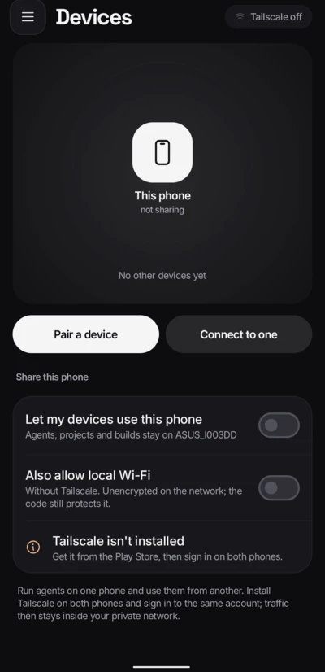

<h1 align="center">Yurlungr</h1>

<p align="center">
  <b>Coding agents in your pocket.</b><br>
  Chat with Claude Code, Codex, Gemini CLI and Antigravity running natively on your Android phone,<br>
  in a built-in Linux runtime. Build, git and ship from the same app. One APK, no Termux install.
</p>

<p align="center">
  
  
  
  
  
</p>

<p align="center">
  
  
  
  
  
</p>

---

## Highlights

- **Real agents, really on-device.** Each chat starts the agent's own CLI and talks to it over the
  [Agent Client Protocol](https://agentclientprotocol.com): streaming replies, thoughts, plans, tool calls
  with diffs, permission prompts, slash commands, model / effort / mode pickers, token use, image and
  file attachments.
- **An embedded Linux.** The official Termux bootstrap and package repos run inside the app (no proot, no
  separate Termux app): Node, git, Python, OpenJDK, Gradle and the Android SDK, all native on arm64.
- **Build APKs on the phone.** One tap sets up the SDK; agents or you run `./gradlew assembleDebug` and
  `yurlungr-install` opens the system installer.
- **Projects & git.** A workspace per project: file tree, Sublime-style editor, changes with diffs,
  commit, pull and push, branches and stashes, and a coloured commit graph. Your GitHub repositories
  (and your organisations') are listed, ready to clone.
- **A real terminal.** Termux's terminal view with sessions, a floating session rail and extra keys.
- **Two phones, one workspace.** Share one phone's agents with another over Tailscale with a pairing
  code; the other phone drives the same chats.
- **Stays alive.** A foreground service keeps agents running with the screen off and notifies you when
  one finishes or needs approval.

## Download

Grab the APK for your phone's CPU from the [latest release](https://github.com/mirimomekiku/yurlungr-android/releases/latest)
and install it (allow installs from your browser or file manager when asked):

| APK | For |
|---|---|
| `yurlungr-<version>-arm64-v8a.apk` | Almost every phone from the last several years (recommended) |
| `yurlungr-<version>-armeabi-v7a.apk` | Older 32-bit phones |
| `yurlungr-<version>-x86_64.apk` / `-x86.apk` | Emulators and x86 devices |
| `yurlungr-<version>-universal.apk` | Any of the above, if you're unsure (slightly larger) |

Not sure? `adb shell getprop ro.product.cpu.abi` prints your phone's ABI. Each release lists SHA-256
checksums in `SHA256SUMS.txt`.

## Quick start

**Requirements:** an Android phone (Android 7.0+; arm64 is the tested target, developed on a ROG Phone 3
with Android 12 and a Pixel 6), about 4 GB free. To build from source: JDK 17+ and USB debugging.

```sh
git clone https://github.com/mirimomekiku/yurlungr-android.git
cd yurlungr-android
./gradlew assembleDebug
adb install -r app/build/outputs/apk/debug/app-debug.apk
```

Then, on the phone:

1. **Set up the Linux environment.** The first-run System checks screen offers *Install* (downloads the
   ~30 MB Termux bootstrap). Fix anything amber: battery optimisation, notifications, and on Android 12+
   the background process limit (the dialog shows the one-time `adb` command).
2. **Install the agents.** Agents → ⟳ (or *Install*) runs `agents-setup.sh` in a terminal: about 1 GB.
3. **Sign in.** Each agent's card has *Sign in*, which opens its own login in a terminal; the browser
   opens by itself and returns to the app.
4. **Chat.** Pick an agent and a project folder on the start screen and type.
5. **Build Android apps** (optional): Settings → System runtime → *Set up* the Android SDK (~600 MB plus
   Gradle downloads, includes a test build).

## Features

<details>
<summary><b>Chat</b></summary>

- Start screen with an agent picker (showing each agent's logo and install / sign-in state), a project
  folder chip and suggestion tiles. The first message is queued until the agent is ready, including
  after a sign-in detour.
- The chat header is the agent pill (`● Claude · Sonnet 5.5 ⌄`); its dot shows the state and its menu has
  the title, folder, context use, *End session* and *Delete chat*. The agent's model, effort and mode are
  pill pickers below it.
- Attachments (＋): photos and files go to `<project>/.yurlungr/attachments/` (git-ignored) and are sent as
  ACP images, embedded text resources or file links, depending on what the agent accepts. Large photos
  are downscaled.
- Chats are saved after every turn and restored as history after a restart; opening one restarts the
  agent and reloads its session (`session/load`).
- Code: `chat/` (`ChatSession`, `ChatScreen`, `Composer`, `AcpExtras`, `Attachments`, `ChatStore`),
  `acp/AcpConnection.kt`.

</details>

<details>
<summary><b>Projects & git</b></summary>

- **Workspace** per project: the name (tap to switch projects or open *All projects*), Branch / Changes /
  To push stat tiles, and Files · Changes · History · Chats tabs, with Chat, Build and Terminal along the
  bottom. The sidebar's *Projects* reopens the last workspace.
- **Files** is a tree with change marks; tapping a file opens the editor.
- **Changes**: per-file diffs, *Commit all*, Pull (`--ff-only`), Push (sets the upstream on first push),
  a standard `.gitignore` when build output shows up, and *Publish to GitHub* (`gh repo create`).
- **Branches** (tap the Branch tile): pull, create, switch (remote branches become tracking branches;
  uncommitted changes can be stashed first or brought along), and stash pop / apply / drop.
- **History** is a commit graph like `git log --graph`, grouped under Today / Yesterday / dates, with
  branch, remote and tag labels, "not pushed" marks, a This branch / All branches filter, and commit
  details with changed files and diffs.
- **All projects** lists folders on the phone and, when `gh` is signed in, your GitHub repositories and
  those of your organisations (grouped by owner), marked Cloned, Local or not cloned, with search.
- **Terminal** from a project offers the terminals already open there, or a new one.
- Git runs with `GIT_TERMINAL_PROMPT=0`, so a missing login fails fast instead of hanging.
- Code: `projects/` (`Git`, `GitGraph`, `ProjectScreen`, `ProjectsScreen`, `HistoryView`, `BranchSheet`).

</details>

<details>
<summary><b>Editor</b></summary>

- Syntax colours for about 25 languages from a small pure-Kotlin lexer, line numbers that follow wrapped
  lines, current-line highlight, undo / redo, find and replace, auto-indent and bracket closing, a symbol
  row above the keyboard, word wrap, read-only mode, and a Ln / Col / language / indent / EOL status bar.
- Themes: Monokai, Mariana, Dracula, One Dark, GitHub Dark, GitHub Light and Solarized Light, plus a text
  size (Settings → Editor).
- *Format with Prettier* runs `npx prettier@3.3.3` in the file's folder (so project config applies) for
  JS/TS/JSON/CSS/SCSS/HTML/Markdown/YAML.
- CRLF files are edited as LF and saved back as CRLF; files over 1 MB or binary files are not opened.
- Code: `editor/`.

</details>

<details>
<summary><b>Terminal</b></summary>

- Termux's `terminal-view` with multiple sessions, a floating session rail (tap the session title),
  `[‹ 1/3 ›]` switching, and two rows of extra keys (esc, ctrl, alt, tab, arrows, home/end, page keys).
- Code: `terminal/`.

</details>

<details>
<summary><b>Agents</b></summary>

| Agent | Installed with | Started as |
|---|---|---|
| Claude Code | npm (`--os=linux --cpu=arm64 --libc=glibc`), then `patchelf` to Termux's glibc loader; a wrapper unsets `LD_PRELOAD` | `claude-agent-acp` with `CLAUDE_CODE_EXECUTABLE` |
| Codex | Termux package `codex` (npm's build does not run on Android) | `codex-acp` with `CODEX_PATH` |
| Gemini CLI | `npm i -g @google/gemini-cli` | `gemini --acp` |
| Antigravity (`agy`) | Google's installer, which installs the native `android_arm64` build | `agy acp` (sign in with `agy acp --login`) |

All of it is scripted in `app/src/main/assets/agents-setup.sh`; re-running it updates the agents. Each
agent also gets a managed "you're on an Android phone" note in its own instructions file
(`~/.claude/CLAUDE.md`, `~/.codex/AGENTS.md`, `~/.gemini/GEMINI.md`). Sign-in state is read from each CLI's
credential file; Antigravity's is not documented, so it shows as *Installed*.

</details>

<details>
<summary><b>Devices (two phones)</b></summary>

- **Share this phone**: a WebSocket server on port 8765, off by default, bound to the Tailscale address
  (100.64.0.0/10) unless *Also allow local Wi-Fi* is on. Clients must send the pairing code first
  (compared in constant time); *New* code disconnects everyone; a single device can be disconnected.
- **Connect to one**: enter the other phone's address and code; its chats appear and work like local ones.
  A client needs no runtime of its own.
- The Devices screen is a live connection map of this phone, the phones using it and saved hosts.
- Code: `remote/` (`RemoteProtocol`, `RemoteServer`, `RemoteClient`).

</details>

<details>
<summary><b>Settings & system checks</b></summary>

- Settings is a grouped list: System runtime (opens System checks), Coding agents, Keep agents running
  (notifications, battery, background process limit), Editor, GitHub and About (version, licences).
- System checks (also the first-run screen) groups Phone · Linux runtime · Tools · Background; areas that
  pass fold away and problems show their fix.
- Code: `setup/`.

</details>

## Documentation

| Doc | What's in it |
|---|---|
| [DESIGN.md](DESIGN.md) | The Bento × Daylight design system: colour and tile tokens, type, shape, components, motion, icons, mascot |
| [ARCHITECTURE.md](ARCHITECTURE.md) | How the embedded runtime, agents over ACP, projects, editor, terminal and two-phone sharing fit together, plus a source map |
| [DEVELOPMENT.md](DEVELOPMENT.md) | Building, testing, opening screens directly, regenerating icons, and cutting a release |

## Limitations

- **Application ID `com.termux`.** Termux's official packages are compiled for `/data/data/com.termux`, so
  Yurlungr cannot be installed next to a real Termux. Building our own bootstrap is future work.
- **targetSdk 28.** Android forbids running binaries from app data at targetSdk 29+, so this is a
  sideloaded app, not a Play Store one.
- `libtermux.so` (JitPack v0.118.3) is not 16 KB page-aligned; fine on current test devices.
- Sign-in detection is a credential-file heuristic; API-key setups show as not signed in.

## Credits

Built on [Termux](https://termux.dev) (bootstrap, packages and terminal libraries) and the
[Agent Client Protocol](https://agentclientprotocol.com) adapters. Bundled assets and their licences
(also shown in Settings → Open-source licenses): [Inter](https://rsms.me/inter/) and
[Space Grotesk](https://github.com/floriankarsten/space-grotesk) (SIL OFL 1.1),
[Phosphor Icons](https://phosphoricons.com) (MIT), agent logos from
[LobeHub Icons](https://github.com/lobehub/lobe-icons) (MIT; trademarks of their owners).
