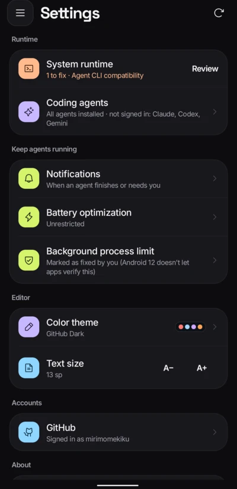

<h1 align="center">Yurlungr</h1>

<p align="center">
  <b>Coding agents in your pocket.</b><br>
  Chat with Claude Code, Codex, Gemini CLI and Antigravity running natively on your Android phone,<br>
  in a built-in Linux runtime. Build, git and ship from the same app. One APK, no Termux install.
</p>

<p align="center">
  
  
  
  
  
</p>

<p align="center">
  
  
  
  
  
</p>

---

## Highlights

- **Real agents, really on-device.** Each chat starts the agent's own CLI and talks to it over the
  [Agent Client Protocol](https://agentclientprotocol.com): streaming replies, thoughts, plans, tool calls
  with diffs, permission prompts, slash commands, model / effort / mode pickers, token use, image and
  file attachments.
- **An embedded Linux.** The official Termux bootstrap and package repos run inside the app (no proot, no
  separate Termux app): Node, git, Python, OpenJDK, Gradle and the Android SDK, all native on arm64.
- **Build APKs on the phone.** One tap sets up the SDK; agents or you run `./gradlew assembleDebug` and
  `yurlungr-install` opens the system installer.
- **Projects & git.** A workspace per project: file tree, Sublime-style editor, changes with diffs,
  commit, pull and push, branches and stashes, and a coloured commit graph. Your GitHub repositories
  (and your organisations') are listed, ready to clone.
- **A real terminal.** Termux's terminal view with sessions, a floating session rail and extra keys.
- **Two phones, one workspace.** Share one phone's agents with another over Tailscale with a pairing
  code; the other phone drives the same chats.
- **Stays alive.** A foreground service keeps agents running with the screen off and notifies you when
  one finishes or needs approval.

## Download

Grab the APK for your phone's CPU from the [latest release](https://github.com/mirimomekiku/yurlungr-android/releases/latest)
and install it (allow installs from your browser or file manager when asked):

| APK | For |
|---|---|
| `yurlungr-<version>-arm64-v8a.apk` | Almost every phone from the last several years (recommended) |
| `yurlungr-<version>-armeabi-v7a.apk` | Older 32-bit phones |
| `yurlungr-<version>-x86_64.apk` / `-x86.apk` | Emulators and x86 devices |
| `yurlungr-<version>-universal.apk` | Any of the above, if you're unsure (slightly larger) |

Not sure? `adb shell getprop ro.product.cpu.abi` prints your phone's ABI. Each release lists SHA-256
checksums in `SHA256SUMS.txt`.

Changes in this version: [0.0.3 release notes](docs/releases/0.0.3.md).

## Quick start

**Requirements:** an Android phone (Android 7.0+; arm64 is the tested target, developed on a ROG Phone 3
with Android 12 and a Pixel 6), about 4 GB free. To build from source: JDK 17+ and USB debugging.

```sh
git clone https://github.com/mirimomekiku/yurlungr-android.git
cd yurlungr-android
./gradlew assembleDebug
adb install -r app/build/outputs/apk/debug/app-arm64-v8a-debug.apk
```

Then, on the phone:

1. **Set up the Linux environment.** The first-run System checks screen offers *Install* (downloads the
   ~30 MB Termux bootstrap). Fix anything amber: battery optimisation, notifications, and on Android 12+
   the background process limit (the dialog shows the one-time `adb` command).
2. **Install the agents.** Agents → ⟳ (or *Install*) runs `agents-setup.sh` in a terminal: about 1 GB.
3. **Sign in.** Each agent's card has *Sign in*, which opens its own login in a terminal; the browser
   opens by itself and returns to the app.
4. **Chat.** Pick an agent and a project folder on the start screen and type.
5. **Build Android apps** (optional): Settings → System runtime → *Set up* the Android SDK (~600 MB plus
   Gradle downloads, includes a test build).

## Features

<details>
<summary><b>Chat</b></summary>

- Start screen with an agent picker (showing each agent's logo and install / sign-in state), a project
  folder chip and suggestion tiles. The first message is queued until the agent is ready, including
  after a sign-in detour.
- The chat header is the agent pill (`● Claude · Sonnet 5.5 ⌄`); its dot shows the state and its menu has
  the title, folder, context use, *End session* and *Delete chat*. The agent's model, effort and mode are
  pill pickers below it.
- Attachments (＋): photos and files go to `<project>/.yurlungr/attachments/` (git-ignored) and are sent as
  ACP images, embedded text resources or file links, depending on what the agent accepts. Large photos
  are downscaled.
- New chats offer **Permissions: Agent default / Skip (YOLO)**. Skip selects the agent's advertised
  full-access ACP mode (or Antigravity's `--dangerously-skip-permissions` launch flag) before sending
  the first prompt, and is remembered with that chat. If the installed agent doesn't expose such a
  mode, the prompt stays queued and the chat shows an error. Existing chats expose the agent's supported
  modes in the mode picker; Antigravity's launch flag requires a new chat to change. Remote new chats
  have the same setup option.
- Replies use GitHub-flavoured CommonMark: headings, nested lists, task lists, quotes and `> [!NOTE]`
  callouts, tables with column alignment, strikethrough, footnotes, bare URLs and clickable links.
  Code blocks get syntax colours for their language, from the editor's lexer and theme, plus a
  **Copy** button. Local file links open in the file viewer (Markdown previews or the text editor);
  remote file links aren't opened on the client. Markdown previews also resolve relative links.
- Chats are saved after every turn and restored as history after a restart; opening one restarts the
  agent and reloads its session (`session/load`).
- Code: `chat/` (`ChatSession`, `ChatScreen`, `Composer`, `AcpExtras`, `Attachments`, `ChatStore`),
  `acp/AcpConnection.kt`.

</details>

<details>
<summary><b>Projects & git</b></summary>

- **Workspace** per project: the name (tap to switch projects or open *All projects*), Branch / Changes /
  To push stat tiles, and Files · Changes · History · Chats tabs. Bottom actions include Chat, Terminal,
  Android Build and web Run when applicable. The sidebar's *Projects* reopens the last workspace.
- **Files** is a tree. In a repository:
  - Every changed file shows a coloured pill (Modified, New, Deleted, Renamed, Conflict), plus "staged" when it's in the next commit.
  - Ignored files are dimmed and tagged, and folders with changes inside get a dot.
  - A filter row with counts (All, Uncommitted, Ignored, Not ignored) and a one-line summary is always shown. Uncommitted lists every changed path, including deletions.
  - Ignored paths come from Git itself, so nested rules, exceptions and global exclusions apply.

  Pull down to re-read the tree and Git's state. Tapping a Markdown file (`.md`, case-insensitive, also
  `.markdown` / `.mdown`) opens a rendered viewer with **Edit** to open the text editor; Back from the
  editor returns to the preview. Other files open in the editor.
- **Changes**: per-file diffs, *Commit all*, a standard `.gitignore` when build output shows up, and
  *Publish to GitHub* (`gh repo create`). **Pull** (`--ff-only`) and **Push**, which sets the upstream on
  the first push, run in a live terminal in a bottom sheet, showing git's progress and any prompts.
  The terminal session ends when git exits. The sheet stays open with the result until you close it.
- **Branches** (tap the Branch tile): pull, create, switch (remote branches become tracking branches;
  uncommitted changes can be stashed first or brought along), and stash pop / apply / drop.
- **History** is a commit graph like `git log --graph`, grouped under Today / Yesterday / dates, with
  branch, remote and tag labels, "not pushed" marks, and a This branch / All branches filter.
  - **Filters:** author, date (today, 7 days, 30 days, a year) and search (message, or a commit hash).
    Git applies them, so they cover the whole history, not just the commits shown.
  - **Commit details:** the changed files and a proper diff viewer, with:
    - +/− counts and line numbers for both sides;
    - added and removed lines tinted, with the changed words highlighted;
    - hunk headers, a wrap toggle and paging for long diffs;
    - a full-screen view.

    The Changes tab uses the same viewer.
- **All projects** lists folders on the phone and, when `gh` is signed in, your GitHub repositories and
  those of your organisations (grouped by owner), marked Cloned, Local or not cloned, with search.
- Pull down to refresh project folders, Git status and GitHub repositories without clearing search
  or filters. **New project** and **Clone from URL** use keyboard-aware bottom sheets with folder
  previews and validation for invalid or existing names.
- **Run locally** appears for detected Vite apps and static HTML sites, alongside Android's Build action
  when both are present. Run setup lets you select an app folder, package manager, Vite script, port,
  dependency installation and optional custom command. Workspace packages install dependencies at the
  workspace root. Detection reads manifests only and checks common app folders without scanning caches.
- Each web run owns a loopback-only address (`127.0.0.1`) and a managed terminal with live logs. The
  project card shows setup/running/failure state, **Open browser**, **Logs**, and confirmed **Stop/Restart**.
  Opening waits for that run's health endpoint; Vite HTTP and HMR are forwarded through its local listener.
  The foreground runtime service keeps runs alive while you use the browser. Stop/Close ends the run's
  process group, while preserving logs unless you close the terminal. App restarts stop stale runs;
  servers do not automatically restart after process death.
- Next.js, Astro, Nuxt, CRA and Angular are detected as candidates; their launch setups still need
  on-device validation. Package presence alone does not make a repository runnable. Custom commands
  must use `127.0.0.1` and the supplied `$PORT`; project-specific native dependencies can still fail on
  Android and their errors remain in Logs. Static serving blocks dotfiles and paths outside the app folder.
- **Terminal** from a project offers the terminals already open there, or a new one.
- **Git** (next to Terminal) opens one-tap routines:
  - **Get latest changes:** saves your uncommitted work, pulls (merging if the branches diverged), then puts your work back (stash → pull → stash pop).
  - **Sync:** the same, then pushes.
  - **Push** or **Publish branch.**
  - **Undo last commit:** only while it's unpushed; keeps the changes.
  - **Branches & stashes.**

  Each routine stops at the first problem and says where things were left. Your work is never discarded.
- **With AI** actions do the same work with an agent of your choice, in a new chat:
  - **Get latest changes & fix conflicts:** runs the routine and, if a pull or the stash pop conflicts, the agent resolves the conflicts. It finishes the merge, or leaves your restored work uncommitted.
  - **Fix merge conflicts.**
  - **Write commit message & commit.**
  - **Review my changes.**

  The agents never push.
- Git runs with `GIT_TERMINAL_PROMPT=0`, so a missing login fails fast instead of hanging.
- Code: `projects/` (`Git`, `GitGraph`, `ProjectScreen`, `ProjectsScreen`, `HistoryView`, `BranchSheet`).

</details>

<details>
<summary><b>Editor</b></summary>

- Syntax colours for about 25 languages from a small pure-Kotlin lexer, line numbers that follow wrapped
  lines, current-line highlight, undo / redo, find and replace, auto-indent and bracket closing, a symbol
  row above the keyboard, word wrap, read-only mode, and a Ln / Col / language / indent / EOL status bar.
- Themes: Monokai, Mariana, Dracula, One Dark, GitHub Dark, GitHub Light and Solarized Light, plus a text
  size (Settings → Editor).
- *Format with Prettier* runs `npx prettier@3.3.3` in the file's folder (so project config applies) for
  JS/TS/JSON/CSS/SCSS/HTML/Markdown/YAML.
- Markdown opens in a read-only rendered viewer with an **Edit** action; other text files open directly
  in the editor. CRLF files are edited as LF and saved back as CRLF; files over 1 MB or binary files
  are not opened. The viewer:
  - renders lazily, so large documents stay smooth;
  - has **Find** (a match count, with previous and next) and an **Outline** sheet of the headings;
  - follows `#section` links and footnotes within the file, using GitHub-style heading anchors;
  - adjusts the text size, shows the raw text, and offers **Copy all** and **Share**;
  - reloads when the file changes on disk, and remembers where you were between Preview and Edit.
- README-style HTML is shown safely:
  - `<details>`/`<summary>` become collapsible sections, which open when a search matches inside them;
  - ``, `<br>`, `<kbd>`, `<sub>`/`<sup>` and similar tags work;
  - script and style contents are dropped, and other tags are stripped, never executed;
  - YAML front matter is shown as a small card.
- Images in the project folder are shown downscaled. Remote images load only after a tap, so opening
  a file doesn't contact their server. SVG images show their alternative text.
- Code: `editor/`.

</details>

<details>
<summary><b>Terminal</b></summary>

- Termux's `terminal-view` with multiple sessions, a floating session rail (tap the session title),
  `[‹ 1/3 ›]` switching, and two rows of extra keys (esc, ctrl, alt, tab, arrows, home/end, page keys).
- Long-press a numbered session tile to open a bottom sheet with **Rename**, **Restart process**,
  **End process**, or **Close session**. Restart, End and Close require confirmation; the rail's ×
  shortcut also asks before closing.
  Ending leaves the exited terminal visible; closing removes the tab. Restart reruns the original session command.
- The **keyboard icon** pill to the right of the session arrows directly shows/hides the extra-key rows,
  remembered across launches. It uses the same container as the session switcher.
- New terminals show a compact status MOTD: current session, working folder,
  Git branch, working/idle chats, approval count, and account sign-in indicators. Run `yurlungr-status`
  to refresh after changing folders or signing in. Sign-in indicators use the same file-presence hints
  as the app; Antigravity stays unknown. No credentials are read or displayed.
  Uses Termux's `~/.termux/motd.sh` hook; an existing custom hook and `$PREFIX/etc/motd` are preserved.
  `~/.hushlogin` still suppresses the automatic welcome, and `NO_COLOR` disables status styling.
- Code: `terminal/`, `runtime/RuntimeStatus.kt`, `assets/motd.sh`.

</details>

<details>
<summary><b>Agents</b></summary>

| Agent | Installed with | Started as |
|---|---|---|
| Claude Code | npm (`--os=linux --cpu=arm64 --libc=glibc`), then `patchelf` to Termux's glibc loader; a wrapper unsets `LD_PRELOAD` | `claude-agent-acp` with `CLAUDE_CODE_EXECUTABLE` |
| Codex | Termux package `codex` (npm's build does not run on Android) | `codex-acp` with `CODEX_PATH` |
| Gemini CLI | `npm i -g @google/gemini-cli` | `gemini --acp` |
| Antigravity (`agy`) | Google's installer, which installs the native `android_arm64` build | `agy acp` (sign in with `agy acp --login`) |
| Qwen Code *(optional)* | `npm i -g @qwen-code/qwen-code` | `qwen --acp` (sign in with `qwen`, then `/auth`) |
| Kimi Code *(optional)* | `npm i -g @moonshot-ai/kimi-code` | `kimi acp` (sign in with `kimi login`) |
| Auggie *(optional)* | `npm i -g @augmentcode/auggie` | `auggie --acp` (sign in with `auggie login`) |
| Command Code *(optional)* | `npm i -g command-code` | `commandcode acp` (sign in with `commandcode login`; its short name `cmd` clashes with Android's own `cmd`) |
| Copilot *(optional)* | `agent-install.sh copilot`: the `@github/copilot-linux-arm64` glibc build, started through Termux's glibc loader | `copilot --acp` (sign in with `copilot login`) |
| Goose *(optional)* | `agent-install.sh goose`: the `aarch64-linux-gnu` release, started through the glibc loader | `goose acp` (set up with `goose configure`) |
| OpenCode *(optional)* | `agent-install.sh opencode`: the `linux-arm64` glibc release, interpreter patched like Claude Code | `opencode acp` (sign in with `opencode auth login`) |

The optional agents are pure Node packages, installed one by one from Agents → More agents. Re-running
the agents setup updates the ones you have. Their sign-in state isn't tracked from files: the chat asks
you to sign in when the agent reports it.

All of it is scripted in `app/src/main/assets/agents-setup.sh`; re-running it updates the agents. Each
agent also gets a managed "you're on an Android phone" note in its own instructions file
(`~/.claude/CLAUDE.md`, `~/.codex/AGENTS.md`, `~/.gemini/GEMINI.md`). Sign-in state is inferred from each CLI's
credential-file presence; Antigravity's is not documented, so it shows as *Installed*.

</details>

<details>
<summary><b>Devices (two phones)</b></summary>

- **Share this phone**: a WebSocket server on port 8765, off by default, bound to the Tailscale address
  (100.64.0.0/10) unless *Also allow local Wi-Fi* is on (private network ranges only). Both phones prove
  they know the pairing code without sending it, and all traffic is then encrypted and authenticated with
  keys derived from it. *New* code disconnects everyone; a single device can be disconnected. Phones on
  Yurlungr 0.0.2 or older can't pair with newer ones: update both.
- **Connect to one**: enter the other phone's address and code; its chats appear and work like local ones.
  A client needs no runtime of its own.
- The Devices screen is a live connection map of this phone, the phones using it and saved hosts.
- Code: `remote/` (`RemoteProtocol`, `RemoteServer`, `RemoteClient`).

</details>

<details>
<summary><b>Settings & system checks</b></summary>

- Settings is a grouped list: System runtime (opens System checks), Coding agents, Keep agents running
  (notifications, battery, background process limit), Appearance, Editor, GitHub and About (version,
  licences). Details and choices open as bottom sheets.
- **Appearance:** System / Light / Dark. *System* follows the phone, and the status and navigation bars
  follow the app's choice.
- System checks (also the first-run screen) groups Phone · Linux runtime · Developer tools · Tools ·
  Background; areas that pass fold away and problems show their fix. Pull down to run them again. Opening it runs every tool (git,
  gh, Node, the agents, the JDK) to check that it works. If the shell or package manager is broken it
  offers to reinstall the base system, keeping your home folder. A failed setup run shows its failed
  steps and a link to its log.
- *Developer tools* setup installs only git, gh, Node.js, ripgrep and termux-exec, without the ~1 GB
  of agents.
- Code: `setup/`.

</details>

## Documentation

| Doc | What's in it |
|---|---|
| [DESIGN.md](DESIGN.md) | The Bento × Daylight design system: colour and tile tokens, type, shape, components, motion, icons, mascot |
| [ARCHITECTURE.md](ARCHITECTURE.md) | How the embedded runtime, agents over ACP, projects, editor, terminal and two-phone sharing fit together, plus a source map |
| [DEVELOPMENT.md](DEVELOPMENT.md) | Building, testing, opening screens directly, regenerating icons, and cutting a release |

## Limitations

- **Application ID `com.termux`.** Termux's official packages are compiled for `/data/data/com.termux`, so
  Yurlungr cannot be installed next to a real Termux. Building our own bootstrap is future work.
- **targetSdk 28.** Android forbids running binaries from app data at targetSdk 29+, so this is a
  sideloaded app, not a Play Store one.
- The terminal JNI library is rebuilt from matching Termux sources with 16 KB alignment.
  APK alignment checks do not replace testing the embedded runtime and agents on a 16 KB device.
- Sign-in detection is a credential-file heuristic; API-key setups show as not signed in.
- Local web runs have been verified with Vite 8.3.6 on arm64. Other frameworks are detected as
  candidates, and project-specific native dependencies or other ABIs still need compatibility testing.
- Alpha release APKs use the debug signing key; see [Development](DEVELOPMENT.md) before changing it.

## Credits

Built on [Termux](https://termux.dev) (bootstrap, packages and terminal libraries) and the
[Agent Client Protocol](https://agentclientprotocol.com) adapters. Bundled assets and their licences
(also shown in Settings → Open-source licenses): [Inter](https://rsms.me/inter/) and
[Space Grotesk](https://github.com/floriankarsten/space-grotesk) (SIL OFL 1.1),
[Phosphor Icons](https://phosphoricons.com) (MIT), agent logos from
[LobeHub Icons](https://github.com/lobehub/lobe-icons) (MIT; trademarks of their owners), and
[CommonMark Java](https://github.com/commonmark/commonmark-java) (BSD 2-Clause) for Markdown parsing.
